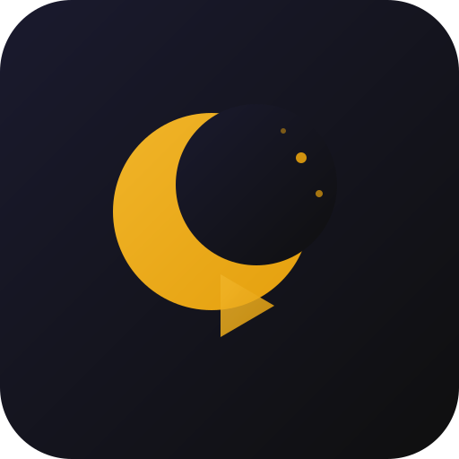

<div align="center">



# Nocturne

### The Definitive Native Windows 11 Desktop Client for Emby

**Ultra-fast direct playback, multi-server library deduplication, automated intro skip, real-time WatchParty, and deep Trakt analytics — powered by pure .NET 8, WPF-UI, and mpv.**

[](https://github.com/tokudai-vs/nocturne/releases/latest)
[-0078D4?style=for-the-badge&logo=windows)](https://github.com/tokudai-vs/nocturne/releases/latest)
[](https://dotnet.microsoft.com/)
[](https://mpv.io/)
[](LICENSE)

<br/>

<p align="center">
  <a href="https://github.com/tokudai-vs/nocturne/releases/latest">
    
  </a>
  &nbsp;&nbsp;
  <a href="#-why-nocturne">
    
  </a>
</p>

*Zero Electron. Zero Chromium overhead. Sub-millisecond browsing powered by local SQLite WAL cache.*

---

</div>

## 🌟 Why Nocturne?

The official Emby desktop and web apps run on Chromium and Electron, consuming 600MB–1GB of memory at idle, struggling with desktop audio codecs, and forcing your server to transcode 4K files that your PC could play natively.

**Nocturne** was engineered from scratch as a high-performance native Windows 11 application to give media enthusiasts the ultimate desktop streaming experience:

* ⚡ **Pure Native Windows Performance**: Crafted in C# with .NET 8 and WPF-UI. Idle memory footprint is under **100 MB**. Navigates in 0ms from an optimized SQLite WAL cache — even with libraries of 1.5M+ items.
* 🎬 **DirectPlay Everything with mpv**: Plays 4K UHD, HDR10, Dolby Vision (P5/P8 tone-mapping), AV1, HEVC 10-bit, DTS-HD Master Audio, and TrueHD Dolby Atmos without ever requesting server transcoding.
* 🌐 **Unified Multi-Server Library**: Connect multiple Emby servers simultaneously. Duplicate movies and TV series are automatically merged into a single clean shelf with an integrated quality version picker (4K Remux, Web-DL, HD) and automatic stream failover.
* 🎛️ **Server Priority & Seamless Failover**: Drag-and-drop server priority reordering. If a server is offline or errors during playback, Nocturne seamlessly fails over to the next highest-quality stream available.
* 📑 **Dedicated Watchlist Navigation & Two-Way Trakt Sync**: Dedicated top-level Watchlist tab (`Home │ Watchlist │ Libraries`) merging Trakt watchlist entries and Emby favorites with 1-click card bookmarking, RFC 7636 PKCE OAuth device authentication, real-time scrobble stream, and TMDB fallback enrichment.
* ⏭️ **Automated TheIntroDB Skipping**: Skips TV show intros, recaps, and credits automatically or via a 1-click amber HUD prompt (`Enter`). Zero server plugins or complex setup required.
* 🍿 **Real-Time Synchronized WatchParty**: Host or join live viewing sessions with friends across different servers with synchronized play, pause, and seek heartbeats.
* 📊 **Deep Trakt.tv Integration & Analytics**: Seamless OAuth scrobbling, Trakt Watchlist virtual library, and interactive GitHub-style viewing heatmaps and statistics.
* 🎨 **Windows 11 Fluent Design**: Native Mica, Acrylic, and Tabbed backdrops with customizable 7-color accent themes, smooth animations, and Netflix-grade timeline scrub thumbnails.

---

## ⚔️ Comparison: Nocturne vs Official Clients

| Feature | **Nocturne** | **Official Emby Desktop** | **Emby Web (Browser)** |
|:---|:---:|:---:|:---:|
| **Architecture** | **Pure Native .NET 8 + WPF-UI** | Electron / Chromium | Web Browser |
| **Idle Memory Footprint** | **~80 – 120 MB** | ~600 – 900 MB | ~400 – 800 MB |
| **Startup & Browse Speed** | **Sub-millisecond (SQLite WAL)** | 5 – 10 seconds | Variable |
| **Playback Engine** | **Embedded mpv (libmpv)** | Chromium HTML5 Video | Browser HTML5 Video |
| **4K HDR10 / Dolby Vision** | **Native GPU DirectPlay** | Often Transcodes | Transcodes |
| **TrueHD Atmos / DTS-HD MA** | **Bitstream & Direct Audio** | Transcodes to AAC | Transcodes to AAC |
| **Multi-Server Deduplication** | **Unified Shelf + Auto-Merge** | ❌ (Separate tabs) | ❌ (Separate tabs) |
| **Multi-Quality Version Picker**| **4K Remux / Web-DL / HD Badges**| ❌ Server clutter | ❌ Server clutter |
| **Automatic Stream Failover** | **Instant Peer Redundancy** | ❌ Playback stops | ❌ Playback stops |
| **Dedicated Watchlist Tab** | **Unified Trakt + Favorites** | ❌ (Separate tabs) | ❌ (Separate tabs) |
| **Automated Intro/Credit Skip** | **Built-in (TheIntroDB)** | ❌ (Plugin dependent) | ❌ (Plugin dependent) |
| **Scrubbing Preview Thumbnails** | **Netflix-Style 16:9 Popups** | Basic | Basic |
| **Timeline Chapter Markers** | **Visual Ticks + Intro Blocks** | Standard | Standard |
| **Real-Time WatchParty** | **Built-in Peer Sync** | ❌ None | ❌ None |
| **Trakt.tv Scrobbler & Sync** | **Two-Way OAuth PKCE + Queue** | ❌ (Plugin / VIP) | ❌ None |
| **TMDB Artwork Enrichment** | **Automatic Token-Bucket Fallback**| ❌ Missing images stay blank | ❌ Missing images stay blank |
| **Windows 11 DWM (Mica / Acrylic)**| **Native Composition** | ❌ Simulated | ❌ None |

---

## 🎯 Feature Highlights

### 🎬 Embedded mpv Video Player
* **Embedded Win32 HWND**: Renders directly inside Nocturne’s window frame with zero lost focus or alt-tab issues.
* **Modern Floating HUD**: Translucent overlay with auto-hide after 2.5s of mouse inactivity.
* **Interactive Timeline Scrubber**:
  * **Netflix-Style Scrubbing Thumbnails**: 16:9 chapter images, titles, and timestamps display smoothly on hover and drag.
  * **Visual Chapter Markers**: Distinct chapter divider ticks and colored TheIntroDB segment bars (Amber for Intros, Sky Blue for Recaps, Violet for Credits).
  * **Live Accurate Timers**: High-frequency IPC polling ensures timeline position and `hh:mm:ss` timers advance without stuttering.
* **Seamless Episode Navigation**:
  * Press `>` mid-playback to advance to the next episode without restarting the player.
  * Press `<` to jump back to the previous episode.
  * Automatic `EOF` auto-advance to keep your binge session going.
* **Audio & Subtitle Track Persistence**: Select your preferred language or audio stream once, and Nocturne remembers it across all episodes in the series.
* **Custom Subtitle Styling**: Customize subtitle borders (`None`, `Thin`, `Medium`, `Thick`), font size, color, and background shading directly in Settings.

---

### 📺 Cinematic Home & Detail Experience
* **Hero Rotating Backdrop**: Ambient high-resolution fanart rotating automatically with synopsis and 1-click play.
* **Continue Watching Row**: 16:9 landscape cards with sleek amber watched progress bars and resume tracking.
* **Plex & Netflix Inspired Detail Pages**:
  * Smooth vertical gradient background fade, content ratings, genre chips, and duration badges.
  * **Circular Cast & Crew Avatars** with smooth horizontal scrolling.
  * **Multi-Quality Version Picker**: Easily select between 4K UHD Remux, 1080p, or alternate encodes across connected servers.
  * **YouTube Trailer Integration**: Watch official trailers directly from the detail view.

---

### 🌐 Multi-Server Architecture, Deduplication & Failover
* **Emby Connect & PIN Login**: Authenticate instantly via `emby.media/pin` with zero local password requirements.
* **Server Priority Reordering**: Custom drag-and-drop server priority ranking in Settings.
* **Smart Quality Tiering**:
  * Merges versions across servers into clean quality badges: `4K Remux`, `4K IMAX`, `4K WEB-DL`, `1080p HD`, `720p`.
  * Clutter-free UI: Server identifiers are abstracted away from media versions to provide a unified streaming experience.
* **Automatic Playback Failover**: If a server is offline or fails mid-stream, Nocturne automatically switches to the next best available quality on an active server without interrupting your session.
* **Unified Continue Watching**: Deduplicates in-progress media across servers and qualities into a single card with synchronized playback timestamps.

---

### 📑 Trakt.tv Two-Way Sync & Watchlist Navigation
* **Dedicated Watchlist Navigation Tab**: Accessible directly from the main header (`Home │ Watchlist │ Libraries`) with instant search, status filters (`All`, `Movies`, `Shows`, `Unowned`), and sorting.
* **1-Click Card & Detail Bookmarks**: Toggle items on or off your watchlist directly from shelf card hover buttons and detail views with instant optimistic UI feedback.
* **Secure PKCE Device Auth**: Device authorization flow with RFC 7636 PKCE S256 (`code_challenge` / `code_verifier`) and Windows DPAPI credential protection — zero client secrets stored or transmitted.
* **Real-Time Scrobble Push Queue**: Ordered stream of playback events (`start`, `pause`, `stop`) delivered reliably to Trakt; automatically prunes stale transient events (> 5m) while guaranteeing scrobble completion.
* **Delta Watched-State Pull**: Detects changes via `/sync/last_activities`, synchronizes watch history with source timestamp fidelity, and replicates progress across sibling versions.
* **TMDB Fallback Artwork Enrichment**: Automatically enriches groups with missing posters, backdrops, or episode stills using a 20 req/s token-bucket rate limiter with season batching.

---

### ⚡ Adaptive Parallel Sync Engine
* **Concurrent Multi-Server Sync**: Syncs multiple Emby servers in parallel rather than sequentially.
* **Latency-Guided Adaptive Batching**: Dynamically tunes batch size (20 to 100 items per request) based on real-time server response times.
* **Expandable Sync Telemetry Card**: Live HUD in the top bar and Settings displaying per-server progress, items processed, and network transfer speeds.

---

### 📊 Watch History Analytics (`/analytics`)
* **3 Data Sources**: Local SQLite cache, Trakt cloud history, or Combined view.
* **Range Filters**: Last 30 Days, Last 90 Days, Last Year, All Time.
* **GitHub-Style Activity Heatmap**: Visualizes your daily watch frequency with quantile amber intensity levels.
* **Detailed Insights**: Total watch hours, weekly average viewing, top completed movies, top TV series, and favorite genre distributions.

---

## ⌨️ Keyboard Shortcuts Reference

| Shortcut | Action |
|:---|:---|
| <kbd>Space</kbd> | Play / Pause |
| <kbd>←</kbd> / <kbd>→</kbd> | Rewind 10s / Fast-forward 10s |
| <kbd>↑</kbd> / <kbd>↓</kbd> | Increase / Decrease Volume |
| <kbd>M</kbd> | Mute / Unmute Audio |
| <kbd>F</kbd> | Toggle Fullscreen |
| <kbd>Enter</kbd> | Skip Intro / Skip Credits prompt |
| <kbd>S</kbd> / <kbd>C</kbd> | Cycle Subtitle Tracks |
| <kbd>A</kbd> | Cycle Audio Tracks |
| <kbd>&gt;</kbd> | Next Episode |
| <kbd>&lt;</kbd> | Previous Episode |
| <kbd>Esc</kbd> | Close Player / Exit Fullscreen |
| <kbd>Ctrl</kbd> + <kbd>K</kbd> | Quick Search Jump |

---

## 📥 Installation

### Method 1: Standalone Installer (Recommended)

1. Download the latest `Nocturne-v4.2.0-Setup.exe` from the [Releases Page](https://github.com/tokudai-vs/nocturne/releases/latest).
2. Run the installer. Nocturne will install automatically and create a Desktop shortcut.
3. Launch Nocturne, sign in via **Emby Connect PIN** or enter your server URL, and start streaming!

---

## 🛠️ Building from Source

### Prerequisites
* [Windows 11 or Windows 10 (Build 19041+)](https://www.microsoft.com/software-download/windows11)
* [.NET 8.0 SDK](https://dotnet.microsoft.com/download/dotnet/8.0)
* [Node.js 18+](https://nodejs.org/) (for packaging scripts)

### Clone & Compile

```bash
# 1. Clone the repository
git clone https://github.com/tokudai-vs/nocturne.git
cd nocturne

# 2. Build the native .NET 8 solution
dotnet build src-native/Nocturne.sln -c Release

# 3. Run the unit test suite
dotnet test src-native/Nocturne.Tests/Nocturne.Tests.csproj

# 4. Generate the standalone installer
node scripts/build-installer.js
```

The compiled installer will be available at `dist/Nocturne-v4.2.0-Setup.exe`.

---

## 🧩 Technology Stack

* **UI Framework**: [WPF-UI (Lepo.i18n)](https://github.com/lepoco/wpfui) — Modern Windows 11 Fluent Design with Mica and Acrylic materials.
* **Core Language**: C# 12 / .NET 8 LTS.
* **Video Engine**: [mpv](https://mpv.io/) — Embedded Win32 HWND direct playback pipeline with hardware acceleration.
* **Database & Cache**: [Microsoft.Data.Sqlite](https://www.nuget.org/packages/Microsoft.Data.Sqlite) with Write-Ahead Logging (WAL) and bounded streaming channels.
* **Third-Party APIs**:
  * [TheIntroDB](https://introdb.app/) — Community crowd-sourced intro & credit skip timestamps.
  * [Trakt.tv API](https://trakt.docs.apiary.io/) — Two-way scrobbling and watchlist synchronization.
  * [The Movie Database (TMDB)](https://www.themoviedb.org/) — Fallback poster, backdrop, and episode still enrichment. *(Note: This product uses the TMDB API but is not endorsed or certified by TMDB.)*

---

## 🤝 Contributing

Contributions, feature requests, and bug reports are welcome!
1. Fork the Project.
2. Create your Feature Branch (`git checkout -b feat/AmazingFeature`).
3. Commit your Changes (`git commit -m 'feat: Add AmazingFeature'`).
4. Push to the Branch (`git push origin feat/AmazingFeature`).
5. Open a Pull Request.

---

## 📄 License

Distributed under the **MIT License**. See [`LICENSE`](LICENSE) for more details.

---

<div align="center">

Crafted with care by [Vishal](https://github.com/tokudai-vs) and the Nocturne community.

*If you love Nocturne, consider starring the repo :star: to support development!*

</div>
