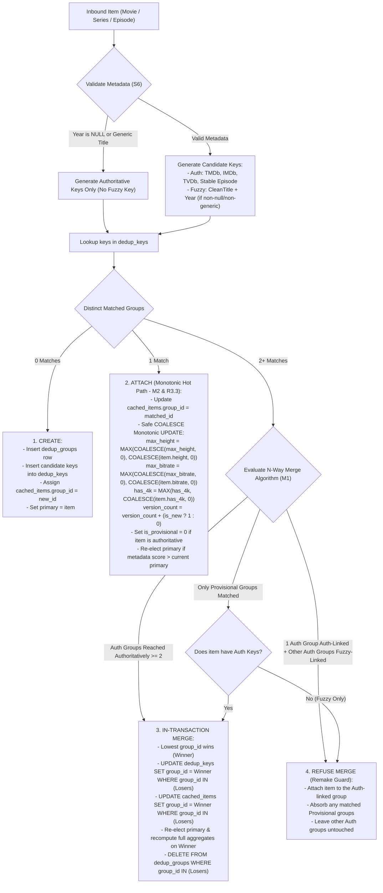
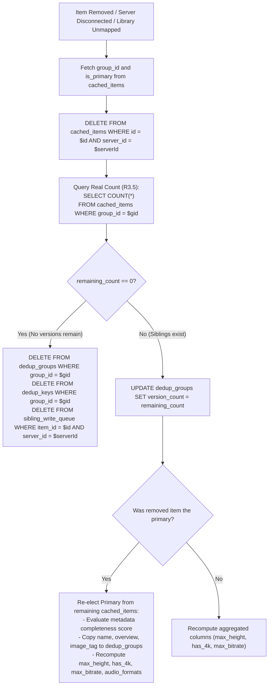
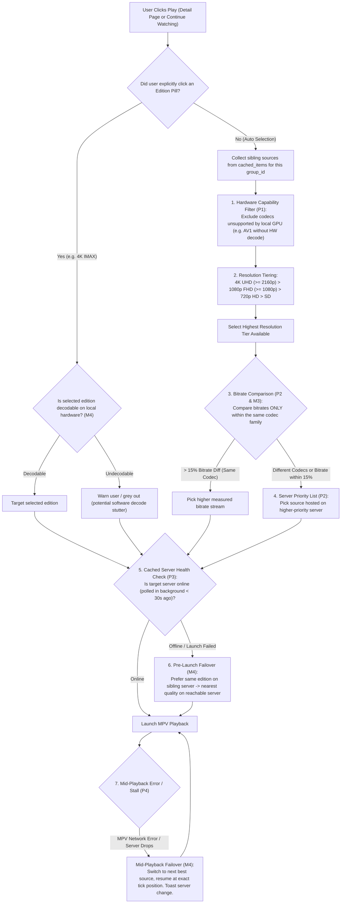
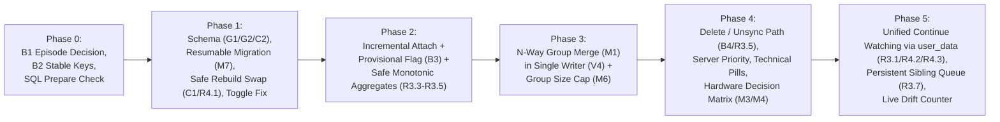

# Nocturne Multi-Quality Deduplication, Server Convergence & Playback Architecture (v4.4 Frozen Master Plan)

## Executive Summary
This document incorporates all lessons from Nocturne v1–v3.5 and the engineering reviews from rounds 1–4 (`nocturne-dedup-plan-review-r4.md`). It resolves all corruption vectors, provides complete SQL specifications for hot paths and migrations, and serves as the frozen specification for implementation.

Key capabilities:
1. **Multi-Quality Convergence**: Merges multiple versions of the same title across servers or within a single server into one clean library entry.
2. **Denormalized Groups + Normalized Streams**: Sub-millisecond shelf reads from `dedup_groups`; normalized media versions in `cached_items` queried only when a detail page opens.
3. **Provisional-Aware Union-Find Incremental Dedup**: Real-time group creation and attachment with an authoritative N-way merge algorithm that absorbs provisional groups while preventing remake fusions.
4. **Stable Episode Keys**: Authoritative keys based on provider series IDs (`ep:tvdb:{id}:s01e01`) prevent series merges from cascading into mass episode re-indexing.
5. **Robust Delete & Unsync Lifecycle**: Full deletion path for removed servers, unmapped libraries, or deleted media—using real count verification to eliminate orphan groups and blank poster cards.
6. **Hardware-Aware Playback Decision Matrix**: Filters by local hardware decode capability first (including explicit pill clicks), then resolves: `Quality Tier → Codec-Normalized Bitrate (Derived from Size/Runtime) → Server Priority → Automatic Failover`.
7. **Clean Technical Edition Pills**: User interface presents clean technical badges (`4K IMAX Enhanced`, `4K BluRay Remux`, `4K WEB-DL`, `1080p BluRay`, `720p HDTV`) with server identity available in tooltips and actionable failure toasts.
8. **Unified Continue Watching via Source-of-Truth User Data**: `user_data` table keyed on `(server_id, item_id)` with query-time bare-column group rollup. Synchronous local completion across all versions eliminates phantom cards. Streaming server receives active playback sessions; sibling servers receive user-data updates at pause/stop/EOF backed by a unique-upsert `sibling_write_queue` and timestamp-based last-write-wins.
9. **Atomic Swap-In Rebuild with Safe Reassignment & Post-Commit Re-Ingest**: Swap-in atomic rebuilds reassign mapped items, explicitly NULL unmapped items, re-create FTS5 triggers, and run incremental ingest post-commit, validated by the `COUNT(*) WHERE group_id IS NULL = 0` assertion and multiset partition hashing.
10. **Resumable Watermarked Migration**: Backfills existing ~950K rows in batches with live UI progress.

---

## 1. Root Cause Analysis & Architectural Decisions

### A. The 0-Dedup Merged Failure (Post-Mortem)
1. **Episode Ingestion Decision (B1)**:
   - **Decision: Keep episodes synced.** TV episodes (~676K items) remain fully synced in SQLite. With normalized `cached_items` and indexed `dedup_groups`, SQLite handles 1.5M rows effortlessly.
   - **The Bug**: `ConcurrentDedupIndex.cs` had `if (item.Type != "Movie" && item.Type != "Series") continue;`, which skipped all 676K episodes. Episodes are essential for Continue Watching, auto-advance, sibling scrobbling, and version picking.
2. **Title Normalization Noise**:
   - Release tags (`[4K Remux]`, `(2010)`, `IMAX Edition`) corrupted title matching when external provider IDs were absent. Clean title extraction now strips technical tags, resolutions, and brackets before generating fuzzy keys.
3. **Database Query Typo & Swallowed Exceptions (V5)**:
   - `DatabaseService.cs(766)` queried `WHERE ... AND year = $year`, but the column is `production_year`.
   - **Root Cause**: SQLite prepare-time errors were silently caught in generic `catch { return ...; }` blocks.
   - **Remedy**:
     - Remove broad try-catches around SQLite calls; let schema/syntax errors fail loudly in debug mode.
     - Implement a startup `DatabaseService.SelfCheckPreparedStatements()` that prepares every SQL query at boot to catch typos instantly.
4. **Settings Rebuild Truncation**:
   - `SettingsViewModel.RebuildDedupIndexAsync` was hardcoded to `limit: 50000`, silently skipping 900,000+ items.

### B. Toggle Switch Visual Slivers
- In `SettingsPage.xaml`, `ui:ToggleSwitch` was placed inside a `DockPanel` with `LastChildFill="True"`. The preceding `StackPanel` expanded to take 100% width, collapsing the toggle switch to its 2px border width.
- **Fix**: Move `ui:ToggleSwitch` first with `DockPanel.Dock="Right"`, `Width="44"`, and `Height="22"`.

---

## 2. Core Database Schema

### Design Decisions:
- **No `json_data` on `dedup_groups` (S1)**: Storing duplicated 4KB JSON blobs on the group row causes overflow page chaining and slows shelf scans. The detail page retrieves the primary's `json_data` from `cached_items` via indexed lookup.
- **Separation of Copied vs. Aggregated Columns (S2)**: Copied metadata (`name`, `overview`, `image_tag`) comes from the elected primary. Aggregates (`max_height`, `has_4k`, `max_bitrate`, `audio_formats`, `version_count`) are aggregated across all active versions in `cached_items`.
- **`WITHOUT ROWID` on `dedup_keys` (S5)**: Halves B-Tree storage overhead and eliminates index-to-rowid indirection for 1.5M+ keys.
- **No `AUTOINCREMENT` on `dedup_groups` (S5)**: Standard `INTEGER PRIMARY KEY` avoids `sqlite_sequence` updates on every write and permits recycling IDs during group merges.
- **`user_data` Keyed on `(server_id, item_id)` (R3.1)**: Emby's native source of truth. Group rollup occurs at query time, making user data 100% immune to group merges, ID reassignments, and batch rebuilds.
- **Durable `sibling_write_queue` with Non-Sticky Upsert (R3.7 & R4.Minor)**: `UNIQUE(server_id, item_id)` ensures only the latest position is queued per server copy, allowing newer `mark_played = 0` to overwrite older completions.
- **Decoupled Foreign Keys (C2)**: `cached_items.group_id` uses an indexed integer without an explicit `REFERENCES` clause, allowing atomic table swaps without SQLite $\ge 3.25$ FK rewriting corruption.
- **FTS5 Search with Self-Repairing Triggers (G2 & R3.2)**: FTS5 external content index over `(name, sort_name)` with triggers re-created during rebuild swaps.

```sql
-- 1. Denormalized groups table (the display entity for shelves/search)
CREATE TABLE dedup_groups (
    group_id         INTEGER PRIMARY KEY,
    item_type        TEXT NOT NULL,            -- 'Movie', 'Series', 'Episode'
    primary_item_id  TEXT NOT NULL,
    primary_server   TEXT NOT NULL,
    is_provisional   INTEGER NOT NULL DEFAULT 0, -- 1 = matched only on fuzzy Name+Year; 0 = has authoritative key
    version_count    INTEGER NOT NULL DEFAULT 1,
    
    -- Metadata copied from the elected primary:
    name             TEXT NOT NULL,
    sort_name        TEXT,
    year             INTEGER,
    overview         TEXT,
    image_tag        TEXT,
    backdrop_tag     TEXT,
    community_rating REAL,
    date_created     INTEGER,
    series_group_id  INTEGER,                  -- for episodes: parent series dedup_groups(group_id)
    season_number    INTEGER,                  -- for episodes
    episode_number   INTEGER,                  -- for episodes
    
    -- Aggregates computed over all sibling versions:
    max_height       INTEGER,                  -- e.g. 2160, 1080
    has_4k           INTEGER NOT NULL DEFAULT 0,
    max_bitrate      INTEGER,
    audio_formats    TEXT                      -- e.g. 'Atmos,TrueHD'
);

-- 2. Union-Find Alias Table (WITHOUT ROWID for minimal footprint and 2x faster lookup)
CREATE TABLE dedup_keys (
    key              TEXT PRIMARY KEY,         -- 'tmdb:movie:550', 'ep:tvdb:81189:s01e01'
    group_id         INTEGER NOT NULL,
    is_authoritative INTEGER NOT NULL DEFAULT 1 -- 1 = TVDb/TMDb/IMDb/StableEpisode; 0 = Fuzzy Name+Year
) WITHOUT ROWID;

-- 3. Normalized items table (per-server media stream copies)
-- Note: group_id is unconstrained by FK to permit atomic rebuild swaps (C2)
CREATE TABLE cached_items (
    id               TEXT NOT NULL,
    server_id        TEXT NOT NULL,
    parent_id        TEXT,
    group_id         INTEGER,
    name             TEXT NOT NULL,
    type             TEXT NOT NULL,
    production_year  INTEGER,
    height           INTEGER,
    width            INTEGER,
    video_codec      TEXT,
    audio_codec      TEXT,
    bitrate          INTEGER,
    size_bytes       INTEGER,
    runtime_seconds  INTEGER,
    hdr_type         TEXT,                     -- 'HDR10', 'DV', 'SDR'
    edition          TEXT,                     -- 'IMAX', 'Remux', 'BluRay', 'WEB-DL'
    json_data        TEXT NOT NULL,
    last_synced      INTEGER NOT NULL,
    PRIMARY KEY (id, server_id)
);

-- 4. User Data State (Native Source of Truth, Immune to Group Rebuilds) (R3.1)
CREATE TABLE user_data (
    server_id       TEXT NOT NULL,
    item_id         TEXT NOT NULL,
    position_ticks  INTEGER NOT NULL DEFAULT 0,
    runtime_ticks   INTEGER,
    played          INTEGER NOT NULL DEFAULT 0,
    last_played_utc INTEGER,                 -- drives last-write-wins
    updated_locally INTEGER NOT NULL DEFAULT 0,
    PRIMARY KEY (server_id, item_id)
) WITHOUT ROWID;

-- 5. Persistent Sibling Write Queue with Non-Sticky Upsert (R3.7 & R4.Minor)
CREATE TABLE sibling_write_queue (
    queue_id       INTEGER PRIMARY KEY AUTOINCREMENT,
    server_id      TEXT NOT NULL,
    item_id        TEXT NOT NULL,
    position_ticks INTEGER,
    mark_played    INTEGER NOT NULL DEFAULT 0,
    queued_utc     INTEGER NOT NULL,
    attempts       INTEGER NOT NULL DEFAULT 0,
    UNIQUE(server_id, item_id)
);

-- 6. Resumable Migration Watermark Table (M7)
CREATE TABLE migration_state (
    key   TEXT PRIMARY KEY,
    value TEXT NOT NULL
);

-- Indexes
CREATE INDEX IF NOT EXISTS ix_items_group ON cached_items(group_id);
CREATE INDEX IF NOT EXISTS ix_items_server_sync ON cached_items(server_id, last_synced);
CREATE INDEX IF NOT EXISTS ix_dedup_keys_group ON dedup_keys(group_id);
CREATE INDEX IF NOT EXISTS ix_dedup_groups_shelf ON dedup_groups(item_type, date_created DESC);
CREATE INDEX IF NOT EXISTS ix_dedup_groups_primary ON dedup_groups(primary_item_id, primary_server);
CREATE INDEX IF NOT EXISTS ix_dedup_groups_series ON dedup_groups(series_group_id, season_number, episode_number);
CREATE INDEX IF NOT EXISTS ix_dedup_groups_sort ON dedup_groups(item_type, sort_name);

-- Partial index on user_data for instant Continue Watching queries:
CREATE INDEX IF NOT EXISTS ix_user_data_continue
    ON user_data(last_played_utc DESC)
    WHERE position_ticks > 0 AND played = 0;

-- FTS5 Full-Text Search with synchronized triggers (G2 & R3.2)
CREATE VIRTUAL TABLE IF NOT EXISTS dedup_groups_fts USING fts5(
    name,
    sort_name,
    content='dedup_groups',
    content_rowid='group_id'
);

CREATE TRIGGER IF NOT EXISTS dg_fts_ai AFTER INSERT ON dedup_groups BEGIN
  INSERT INTO dedup_groups_fts(rowid, name, sort_name)
    VALUES (new.group_id, new.name, new.sort_name);
END;

CREATE TRIGGER IF NOT EXISTS dg_fts_ad AFTER DELETE ON dedup_groups BEGIN
  INSERT INTO dedup_groups_fts(dedup_groups_fts, rowid, name, sort_name)
    VALUES ('delete', old.group_id, old.name, old.sort_name);
END;

CREATE TRIGGER IF NOT EXISTS dg_fts_au AFTER UPDATE ON dedup_groups BEGIN
  INSERT INTO dedup_groups_fts(dedup_groups_fts, rowid, name, sort_name)
    VALUES ('delete', old.group_id, old.name, old.sort_name);
  INSERT INTO dedup_groups_fts(rowid, name, sort_name)
    VALUES (new.group_id, new.name, new.sort_name);
END;
```

---

## 3. Incremental Deduplication & N-Way Group Merging

Incremental deduplication is order-dependent. Items arrive sequentially and must be merged atomically within the sync pipeline's single writer thread (**V4**).

### A. The N-Way Merge Algorithm (Resolution to M1 & B3)
Because `dedup_keys.key` is a primary key, two groups never share a key directly. The trigger for a merge is that **an inbound item carries authoritative keys that resolve to two or more distinct groups**.

When an item matches $N$ distinct groups via candidate key lookup:
1. **Partition Matches**: Split matched groups into `AuthGroups` (`is_provisional = 0`) and `ProvisionalGroups` (`is_provisional = 1`).
2. **Count Authoritative Links**: Identify which groups were reached via the item's *authoritative* keys vs. its *fuzzy* key.
3. **Evaluate Merge**:
   - **Case 1: Multiple Authoritative Groups Reached Authoritatively ($\ge 2$)**:
     $\rightarrow$ **MERGE ALL** matched authoritative groups into the lowest `group_id` (the Winner). Absorb all matched provisional groups into the Winner.
   - **Case 2: One Authoritative Group Reached Authoritatively**:
     $\rightarrow$ **ATTACH ONLY** to this authoritative group. Absorb all matched provisional groups into it. **DO NOT** merge any other authoritative group reached solely via fuzzy keys (remake protection).
   - **Case 3: Only Provisional Groups Matched**:
     $\rightarrow$ If item has authoritative keys: **MERGE ALL** provisional groups into lowest `group_id` and clear `is_provisional = 0`.
     $\rightarrow$ If item has fuzzy key only: **ATTACH ONLY** to the lowest-id provisional group (never merge provisional groups on fuzzy evidence alone).
   - **Case 4: Zero Groups Matched**:
     $\rightarrow$ **CREATE** new group (`is_provisional = 1` if created only with a fuzzy key; `0` if item has authoritative keys).



### B. Hot-Path Monotonic Aggregates with Safe COALESCE (M2, R3.3, R3.4, R3.5)
On item attachment (>98% of sync operations), Nocturne **never runs a `SELECT ...` over siblings**.
Aggregates are updated in-place via monotonic SQL using `COALESCE` to guard against NULL propagation and delimited strings to prevent substring collisions:

```sql
UPDATE dedup_groups SET
    max_height    = MAX(COALESCE(max_height, 0),  COALESCE($itemHeight, 0)),
    max_bitrate   = MAX(COALESCE(max_bitrate, 0), COALESCE($itemBitrate, 0)),
    has_4k        = MAX(has_4k, COALESCE($is4k, 0)),
    version_count = version_count + $isNewItem,
    audio_formats = CASE 
        WHEN audio_formats IS NULL OR audio_formats = '' THEN $itemAudio
        WHEN instr(',' || audio_formats || ',', ',' || $itemAudio || ',') > 0 THEN audio_formats
        ELSE audio_formats || ',' || $itemAudio
    END,
    is_provisional = CASE WHEN $isAuthItem THEN 0 ELSE is_provisional END
WHERE group_id = $groupId;
```
Full aggregate recomputation (`SELECT MAX(height), ... FROM cached_items WHERE group_id = ?`) is executed strictly during **DELETE** and **MERGE**.

### C. Guarding Fuzzy Keys & Group Size Caps (S6, M6, R4.Minor)
- **Fuzzy Guard**: Never emit a fuzzy key `name:movie:{cleantitle}:{year}` if `production_year` is NULL, 0, or if title is generic ("Episode 1", "Pilot").
- **Group Size Cap (M6 & R4.Minor)**: A legitimate group across $N$ servers has 2–6 versions. Cap fuzzy attach at:
  $$\text{MaxGroupSize} = 4 \times \text{ConnectedServerCount} \quad (\text{8 for 2 servers})$$
  If an incoming fuzzy attach would exceed this cap, reject the attach, log a diagnostic warning, and flag the group in the Settings drift diagnostics panel. Merges resulting in $> 8$ versions (e.g. 5 editions on 2 servers) are permitted but flagged in drift diagnostics for visibility.

### D. Deterministic Primary Election (S3)
The primary version is elected using a deterministic scoring function completely decoupled from stream resolution:

$$\text{Score} = (\text{HasBackdrop} \times 100) + (\text{HasPoster} \times 50) + (\text{HasOverview} \times 30) + (\text{HasRating} \times 10) + \text{ServerPriorityBonus}$$

1. **Metadata Completeness**: Higher score wins.
2. **Server Priority**: User's drag-and-drop server order.
3. **Lexicographical ID**: Final tiebreak on `(server_id, item_id)` for 100% deterministic reproducibility.

---

## 4. Episode Deduplication via Stable Provider Keys (B2)

Episodes are keyed directly on authoritative series provider IDs, rendering them immune to series group merges:

```
1. Authoritative Provider Keys (stable forever across series merges):
   ep:tvdb:{seriesTvdbId}:s{Season:00}e{Episode:00}      (is_authoritative = 1)
   ep:tmdb:{seriesTmdbId}:s{Season:00}e{Episode:00}      (is_authoritative = 1)
   ep:imdb:{seriesImdbId}:s{Season:00}e{Episode:00}      (is_authoritative = 1)

2. Direct Episode Provider Keys (if present on episode):
   imdb:ep:{imdbEpisodeId}                                (is_authoritative = 1)
   tmdb:ep:{tmdbEpisodeId}                                (is_authoritative = 1)

3. Fallback Key (only for series with zero external IDs):
   ep:grp:{series_group_id}:s{Season:00}e{Episode:00}   (is_authoritative = 0)
```

**Outcome**: When two series merge, only rare fallback-keyed episodes need key updates; all provider-backed episodes match immediately without cascading merges.

---

## 5. Deletion & Unsync Lifecycle (B4, R3.5)

When a server is disconnected, a library unmapped, or an item deleted:



---

## 6. Hardware-Aware Playback Decision Matrix & Clean Badges



### A. Measured Bitrate Derivation (M3)
Nocturne **never uses synthetic container guesses**. Bitrate is derived from measured file properties:
$$\text{Bitrate} = \begin{cases} 
\text{bitrate} & \text{if } \text{bitrate} > 0 \\ 
\left\lfloor \frac{\text{size\_bytes} \times 8}{\text{runtime\_seconds}} \right\rfloor & \text{if } \text{size\_bytes} > 0 \text{ and } \text{runtime\_seconds} > 0 \\
\text{NULL} & \text{otherwise}
\end{cases}$$
If bitrate cannot be measured, it drops out of the comparison and falls through directly to Server Priority.

### B. Explicit Pill Selection & Edition Failover (M4)
- **Hardware Filter on Pills**: Undecodable pills (e.g., 4K AV1 on a GPU without AV1 hardware decode) display a warning chip or are greyed out with tooltip: *"Hardware decode unavailable on this GPU"*.
- **Edition-Preserving Failover**: If an explicit pill fails (e.g., 4K IMAX on Raptor), failover searches for the **same edition on a sibling server first** before downgrading quality. Toast announces:
  > *"Raptor unreachable — playing 4K IMAX Enhanced from Valkyrie"*

---

## 7. Unified Continue Watching & Persistent Sibling Queue (R3.1, R4.2, R4.3)

### A. Single Unified Card via Native Bare-Column Query (R3.1 & R4.3)
Continue Watching queries `user_data` and rolls up to `dedup_groups` using SQLite's documented bare-column aggregate behavior:
```sql
SELECT g.*,
       MAX(u.last_played_utc) AS latest_played,
       u.position_ticks,          -- from the row producing latest_played
       u.runtime_ticks,
       u.server_id, u.item_id     -- identifies the most recently played version
FROM user_data u
JOIN cached_items c ON c.id = u.item_id AND c.server_id = u.server_id
JOIN dedup_groups g ON g.group_id = c.group_id
WHERE u.position_ticks > 0 AND u.played = 0
GROUP BY g.group_id
ORDER BY latest_played DESC
LIMIT 20;
```
This guarantees that resume retrieves the **most recently played position** (not the largest position) and targets the exact server version last watched.

### B. Synchronous Local Completion Across All Versions (R4.2)
When an episode or movie reaches completion ($\ge 90\%$) or is explicitly marked played/unwatched:
- **Synchronous Local Write**: Nocturne immediately executes:
  ```sql
  UPDATE user_data
     SET played = 1, position_ticks = 0, last_played_utc = $utcNow, updated_locally = 1
   WHERE (server_id, item_id) IN (
       SELECT server_id, id FROM cached_items WHERE group_id = $groupId
   );
  ```
  This immediately removes the card from Continue Watching across all servers with zero delay.
- **Asynchronous Remote Queue**: Sibling write requests are enqueued in `sibling_write_queue` for remote background propagation.

### C. Session Isolation & Sibling Queue with Non-Sticky Upsert (R3.7 & R4.Minor)
- **Active Streaming Server**: Receives `ReportPlaybackProgressAsync` (10s ticks) to maintain transcode buffers.
- **Sibling Servers**:
  - Receive zero session announcements.
  - Sibling progress is updated **only at Pause, Stop, and EOF** via direct user-data endpoints (`/Users/{userId}/PlayedItems/{itemId}/UserData`).
  - Sibling updates are queued with non-sticky upsert into SQLite `sibling_write_queue`:
    ```sql
    INSERT INTO sibling_write_queue(server_id, item_id, position_ticks, mark_played, queued_utc)
    VALUES($serverId, $itemId, $ticks, $played, $utcNow)
    ON CONFLICT(server_id, item_id) DO UPDATE SET
        position_ticks = excluded.position_ticks,
        mark_played    = excluded.mark_played,  -- newer write always wins (R4.Minor)
        queued_utc     = excluded.queued_utc;
    ```
  - Drained in `queued_utc ASC` order, eliminating rewind races and surviving app restarts.
- **Timestamp-Based Last-Write-Wins**: Local database stores `last_played_utc`. Background sync never clobbers a newer local position with older server data.

---

## 8. Atomic Swap-In Rebuild with Safe Reassignment & Post-Commit Ingest (C1, C2, R4.1)

### A. Atomic Rebuild & Group Reassignment (R4.1)
To eliminate cross-group pointer corruption, SQLite FK rewriting bugs, trigger destruction, and unmapped item stale ID leaks:
1. Rebuild generates `dedup_groups_rebuild`, `dedup_keys_rebuild`, and an item mapping table:
   ```sql
   CREATE TABLE item_group_rebuild (
       id        TEXT NOT NULL,
       server_id TEXT NOT NULL,
       group_id  INTEGER NOT NULL,
       PRIMARY KEY (id, server_id)
   ) WITHOUT ROWID;
   ```
2. The atomic swap executes inside a single transaction:
   ```sql
   PRAGMA legacy_alter_table = ON;
   BEGIN TRANSACTION;
   
   -- 1. Swap groups and keys
   DROP TABLE IF EXISTS dedup_groups_old;
   DROP TABLE IF EXISTS dedup_keys_old;
   ALTER TABLE dedup_groups RENAME TO dedup_groups_old;
   ALTER TABLE dedup_keys RENAME TO dedup_keys_old;
   ALTER TABLE dedup_groups_rebuild RENAME TO dedup_groups;
   ALTER TABLE dedup_keys_rebuild RENAME TO dedup_keys;
   DROP TABLE dedup_groups_old;
   DROP TABLE dedup_keys_old;
   
   -- 2. Re-create FTS5 triggers destroyed by table rename (R3.2)
   DROP TRIGGER IF EXISTS dg_fts_ai;
   DROP TRIGGER IF EXISTS dg_fts_ad;
   DROP TRIGGER IF EXISTS dg_fts_au;
   
   CREATE TRIGGER dg_fts_ai AFTER INSERT ON dedup_groups BEGIN
     INSERT INTO dedup_groups_fts(rowid, name, sort_name)
       VALUES (new.group_id, new.name, new.sort_name);
   END;
   CREATE TRIGGER dg_fts_ad AFTER DELETE ON dedup_groups BEGIN
     INSERT INTO dedup_groups_fts(dedup_groups_fts, rowid, name, sort_name)
       VALUES ('delete', old.group_id, old.name, old.sort_name);
   END;
   CREATE TRIGGER dg_fts_au AFTER UPDATE ON dedup_groups BEGIN
     INSERT INTO dedup_groups_fts(dedup_groups_fts, rowid, name, sort_name)
       VALUES ('delete', old.group_id, old.name, old.sort_name);
     INSERT INTO dedup_groups_fts(rowid, name, sort_name)
       VALUES (new.group_id, new.name, new.sort_name);
   END;
   
   -- 3a. Reassign mapped items (C1 & R4.1)
   UPDATE cached_items
      SET group_id = (SELECT r.group_id FROM item_group_rebuild r
                       WHERE r.id = cached_items.id
                         AND r.server_id = cached_items.server_id)
    WHERE EXISTS (SELECT 1 FROM item_group_rebuild r
                   WHERE r.id = cached_items.id
                     AND r.server_id = cached_items.server_id);
                     
   -- 3b. Clear unmapped items to NULL so they never hold stale IDs (R4.1)
   UPDATE cached_items
      SET group_id = NULL
    WHERE NOT EXISTS (SELECT 1 FROM item_group_rebuild r
                       WHERE r.id = cached_items.id
                         AND r.server_id = cached_items.server_id);
                         
   DROP TABLE item_group_rebuild;
   
   -- 4. Rebuild FTS5 index (G2)
   INSERT INTO dedup_groups_fts(dedup_groups_fts) VALUES('rebuild');
   
   COMMIT;
   PRAGMA legacy_alter_table = OFF;
   ```
3. **Post-Commit Ingest Pass (R4.1)**:
   Immediately after `COMMIT`, Nocturne runs incremental ingest over all items `WHERE group_id IS NULL`:
   ```csharp
   var unmapped = _db.GetItemsWithNullGroupId();
   foreach (var item in unmapped)
   {
       _dedupIndex.IngestItem(item);
   }
   ```
   This ensures concurrent sync writes during the rebuild are properly homed, making rebuild-during-sync 100% correct.

### B. Resumable Watermarked Migration (M7)
Existing ~950K rows are migrated in-place during Phase 1:
- Backfills `height`, `bitrate`, `video_codec`, `edition`, and `runtime_seconds` by parsing `json_data` in batches of 5,000 items.
- Watermark is tracked in `migration_state(key, value)`. If interrupted, migration resumes from the last completed batch.
- Displays live progress in the sync UI so first launch is smooth and responsive.

### C. Partition-Hash Equivalence Oracle (V1 & M5)
- **Validation Metric**: Compute multiset of hashes over sorted `(server_id, item_id)` group members:
  $$\mathcal{M} = \text{sort}\left(\{\text{SHA256}(\text{sort}(\{(s, i) \in G\})) \mid G \in \text{Groups}\}\right)$$
- **Phase 1 Verification Gate (M5 & R4.1)**:
  1. **Determinism Test**: Run rebuild twice over `cached_items`; partition hashes must match 100%.
  2. **Zero Unmapped Gate**: `SELECT COUNT(*) FROM cached_items WHERE group_id IS NULL` must be 0.
  3. **Baseline Record**: Record new multiset hash as the v4 baseline.

---

## 9. Implementation Phasing & Verification Gates



| Phase | Core Deliverables | Verification Gate |
|---|---|---|
| **Phase 0** | • Lock in Episode Sync (**B1: Option A**).<br>• Implement stable provider episode keys (**B2**).<br>• Add `DatabaseService.SelfCheckPreparedStatements()` (**V5**).<br>• Remove broad SQLite exception swallowing. | Deliberately corrupted SQL query triggers fail-fast exception at boot. |
| **Phase 1** | • Create `dedup_groups`, `dedup_keys` (`WITHOUT ROWID`), `user_data` (keyed on `server_id, item_id`), `sibling_write_queue` (`UNIQUE`), and FTS5 triggers (**G1, G2, C2, R3.1**).<br>• Resumable watermarked migration over existing ~950K items (**M7**).<br>• Safe atomic swap-in rebuild with NULLing, post-commit ingest, and trigger restoration (**C1, R3.2, R4.1**).<br>• Fix `ui:ToggleSwitch` layout in `SettingsPage.xaml`. | **Determinism & Zero-Null Gate (M5, R4.1)**:<br>• Rebuilding twice over `cached_items` yields identical partition hashes.<br>• `COUNT(*) WHERE group_id IS NULL` is 0.<br>• Toggle switches render 44x22px. |
| **Phase 2** | • Incremental ingestion with `is_provisional` flag.<br>• Monotonic in-place updates with safe `COALESCE` and comma-delimited `audio_formats` (**R3.3, R3.4**).<br>• Correct `version_count` increment on new items only (**R3.5**).<br>• Attach logic only (no merging yet). | **Gate (R3.8)**: Partition hash matches rebuild on a clean non-colliding corpus (all items have authoritative IDs, no fuzzy merges reachable). |
| **Phase 3** | • Implement N-way merge algorithm in sync pipeline's single writer thread (**M1, V4**).<br>• Tighten group size cap to $4 \times \text{servers}$ with drift diagnostics (**M6, R4.Minor**).<br>• Guard fuzzy keys against NULL years and generic titles (**S6**). | Multiset partition hash $\mathcal{M}_{\text{incremental}} \equiv \mathcal{M}_{\text{rebuild}}$ after full sync across Valkyrie and Raptor. |
| **Phase 4** | • Full deletion and un-sync lifecycle with real count check (**B4, R3.5**).<br>• Clean up orphaned `sibling_write_queue` entries on delete.<br>• Drag-and-drop server priority in Settings (`ServerPriority`).<br>• Technical quality pills with hardware check and safe attribution (**M4, P5**).<br>• Playback decision matrix with derived bitrates and edition failover (**M3, M4**). | Remove a server: zero orphan groups, zero blank cards. Playback selects 4K, falls back to 1080p if server drops. |
| **Phase 5** | • Unified Continue Watching via bare-column `user_data` rollup query (**R3.1, R4.3**).<br>• Synchronous local completion write across all group versions (**R4.2**).<br>• Sibling user-data scrobbles backed by persistent `sibling_write_queue` with non-sticky upsert (**R3.7, R4.Minor**).<br>• Last-write-wins conflict resolution.<br>• Surface live drift counter in Settings $\rightarrow$ Cache. | Stop episode at 50% on Valkyrie: persistent queue updates Raptor without phantom session; local resume card updates to 50%. Complete episode at 100%: card disappears immediately across all server siblings. |
